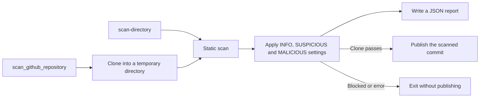

# scan_github_repository

> This analysis script was created for a presentation at CODE BLUE 2026.

[日本語](README.md) · [Changelog](CHANGELOG.md)

Clone a Git repository into a temporary directory, scan it, and publish the exact commit if it passes your policy. Use `scan-directory` to scan a directory you already have.



## Use on Ubuntu

You need Python 3.10 or later, Git, and pip. Run the examples from the tool's directory.

### 1. Get the source and install

```sh
git clone https://github.com/LAC-Japan/scan_github_repository.git
cd scan_github_repository
```

If you want to use a virtual environment, create and activate it before installing.

```sh
python3 -m venv .venv
source .venv/bin/activate
```

Install the dependencies into the current Python environment. Run the remaining commands from this tool’s directory.

```sh
python3 -m pip install -r requirements.txt
```

When upgrading from `scan-clone`, you can continue using existing synchronized data and the `SCAN_CLONE_DATA_DIR` setting. Wheel installations provide the old `scan-clone` command as an alias.

### 2. Get package intelligence with `sync-package`

Run this command before your first scan.

```sh
python3 -m scan_github_repository.sync_package
```

| Source | Data imported |
| --- | --- |
| [OSV's PyPI export](https://google.github.io/osv.dev/data/#per-ecosystem-downloads) | Default. Imports package names and affected versions from OpenSSF Malicious Packages `MAL-…` advisories and skips withdrawn reports. |
| [Datadog's PyPI manifest](https://github.com/DataDog/malicious-software-packages-dataset/blob/main/samples/pypi/manifest.json) | Optional. Adds malicious package names and any affected versions identified in the manifest. |

To use both sources, run this command for the initial sync and subsequent updates.

```sh
python3 -m scan_github_repository.sync_package --datadog
```

The command writes advisory metadata to a local `malicious_packages.csv`. The default directory is `~/.local/share/scan_github_repository/` on Linux and `%LOCALAPPDATA%\scan_github_repository` on Windows. When set, `XDG_DATA_HOME` takes precedence. Use `--data-dir` on each command or set `SCAN_GITHUB_REPOSITORY_DATA_DIR` to customize the location.

A successful sync replaces the CSV. After a failed sync, the previous CSV is still usable. Before the first sync, scans return `missing_intelligence` and exit code 2. To initialize from a previously downloaded OSV export, run the following command.

```sh
python3 -m scan_github_repository.sync_package --osv-archive ./all.zip
```

#### How package intelligence contributes to findings

The scanner compares the package names and version constraints it reads from a PoC's dependency files, such as `requirements.txt` and `pyproject.toml`, with the synchronized CSV. A package reported malicious across all versions or a pin to a confirmed compromised version produces a `MALICIOUS` finding. An unpinned dependency or a range that may allow a compromised version produces a `SUSPICIOUS` finding. The scanner can also flag Python imports mapped to specific known malicious packages. Use `category`, `file`, `line`, and `dependency` on dependency findings to trace the decision in the JSON report. The CSV's `sources` column records advisory provenance.

### 3. Choose what to scan

#### Clone and scan a new checkout

```sh
python3 -m scan_github_repository https://example.org/team/project.git ./checkout
```

A checkout that passes the scan is placed at `./checkout`. Replace the example URL with your repository URL and create the destination's parent directory first. The command accepts HTTPS, SSH, and local paths. For private repositories, use a preconfigured authentication method such as an SSH agent. On Ubuntu the destination filesystem must support `renameat2(RENAME_NOREPLACE)`.

#### Scan an existing clone

```sh
python3 -m scan_github_repository.scan_cli ~/work/existing-repository
```

This scans the current files in the working tree in place, including uncommitted changes.

#### Scan a local directory

```sh
python3 -m scan_github_repository.scan_cli ./extracted-poc
```

You can point the scanner at an extracted PoC or a subdirectory of a repository. The scan walks recursively from the directory you specify.

## Configure detections

| Configuration file | Examples of default classifications |
| --- | --- |
| [info.toml](scan_github_repository/config/info.toml) | Privacy-focused email services |
| [suspicious.toml](scan_github_repository/config/suspicious.toml) | Short URLs, executable `.pth` files, ranges that may include compromised versions |
| [malicious.toml](scan_github_repository/config/malicious.toml) | Known malicious packages and dependencies pinned to known compromised versions |

```sh
mkdir -p local-policy
cp scan_github_repository/config/*.toml local-policy/
python3 -m scan_github_repository.scan_cli --config-dir ./local-policy ./existing-project
```

- To **change a rule's severity**, move its entry to `[rules]` in the desired severity file. Keep each rule in exactly one file.
- To **disable a rule**, set its value in `[rules]` to `false`. Matching findings are omitted from the report and verdict.
- To **report a severity without blocking**, set `block = false` in its file. The default policy records INFO and blocks on SUSPICIOUS or MALICIOUS findings. Custom policies from 0.2 keep their existing blocking settings for each severity, including for the new rules.

Both commands write JSON to standard output. `verdict` is the highest enabled finding severity, `blocked` indicates a policy block, and `incomplete` indicates incomplete coverage. Continue publication only on exit code 0. `rules_sha256` identifies the policy and detector inputs. The clone command also reports the commit SHA. `--scan-timeout` defaults to 120 seconds and `--clone-timeout` to 300 seconds.

| Exit code | Meaning |
| --- | --- |
| 0 | Policy passed. Clones are published |
| 1 | At least one finding blocks the operation |
| 2 | Configuration, clone, scan, or publication error, timeout, or incomplete scan |

## Project layout

```text
scan_github_repository/
  __main__.py                 python -m scan_github_repository entry point
  clone_cli.py                Clone, scan, and publish
  scan_cli.py                 scan-directory entry point
  cli_support.py              Shared command options and reporting
  scanner.py                  Static scan and result classification
  source_checks.py            Python import and command pattern checks
  policy.py                   Load and validate classification settings
  intelligence.py             Load and validate package intelligence
  sync_package.py             Download and validate public advisory metadata
  config/                     One TOML file per severity
  vendor/                     Detector adapted from Aramasa
```

## Scan coverage

Directory depth is unlimited by default. For a bounded first review, use `python3 -m scan_github_repository.scan_cli --max-depth 4 ./existing-project`. The same option is available on `scan_github_repository`. The input root is at depth 0, and files at the selected depth are scanned. If the limit skips a directory or an included requirements file, the command returns exit code 2 and withholds publication. The JSON report lists skipped counts under `stats.directories_skipped_depth` and `stats.requirement_includes_skipped_depth`. Rerun without the limit for full coverage.

The scanner checks text files and supported Python dependency declarations in the initial checkout or supplied directory. It walks directories other than `.git` and follows local requirements and constraints includes. It never executes target code or dependency installers. Dependencies reported as malicious with unknown affected versions and version ranges that may include compromised releases are reported as SUSPICIOUS.

| Detection | Default handling |
| --- | --- |
| Python import mapped to a malicious package by published research | MALICIOUS. Local implementations, relative imports, comments, and strings are excluded |
| A shell script pipes a literal HTTP(S) URL from `curl` or `wget` into a shell | SUSPICIOUS |
| The same command in documentation, or a shortened URL used as a reference in documentation or a comment | INFO |
| A shortened URL presented as a Markdown download link | SUSPICIOUS |
| ELF, PE, and Mach-O files | Incomplete scan. JSON reports each format separately |

The commands return exit code 2 for read errors, files larger than 5 MiB, unreadable text, executable formats, archives, LFS pointers, links, special files, or unresolved requirements includes. The clone command also checks the Git index for submodules and symbolic links. Counts appear in the JSON `stats` or `unsupported` object.

The malicious import check uses the verified mappings in `source_checks.py`, and shell detection covers simple pipelines written directly in the source. Git history, the contents of other binary formats, dynamic imports, commands assembled from variables, dependencies resolved at install time, and unknown malware remain outside this coverage. Use a stable directory for standalone scans.

### Add package intelligence

Scans use the synchronized local CSV. Use `--intel-csv` to supplement it with reviewed or private intelligence. The scanner performs no network requests to fetch or update intelligence.

```sh
python3 -m scan_github_repository.scan_cli --intel-csv ./trusted-intel.csv ./existing-project
```

Use UTF-8 and include the columns `package,policy,versions,ranges,sources`. Set the policy to `all_versions` or `versions_only`. Separate multiple versions or ranges within their respective columns with semicolons. Express ranges using Python version specifiers. The extra CSV adds to the synchronized intelligence. Only provide intelligence files controlled by the operator.

This example flags `example-library` version `1.4.2` and versions from `2.0` inclusive to `2.3` exclusive.

```csv
package,policy,versions,ranges,sources
example-library,versions_only,1.4.2,">=2.0,<2.3",Advisory URL
```

An affected pin is MALICIOUS. An unpinned requirement or a range that may allow an affected release is SUSPICIOUS. A requirement proven disjoint from the affected versions produces no finding for this rule. Version findings include the declared `dependency` in JSON. An all-versions entry in the extra CSV preserves an existing version-limited rule for the same name. The JSON lists such conflicts under `intel_scope_conflicts` when the scanned project references the dependency.

A direct reference to a same-named Git fork or other unverified artifact is SUSPICIOUS. For a same-named wheel or source distribution on PyPI's official file host, the scanner checks the version in the filename. OSV fixed-version boundaries include earlier prereleases.

## License

Commercial use of scan_github_repository is prohibited. See the [project license](LICENSE) and [third-party notices](NOTICE.md).

