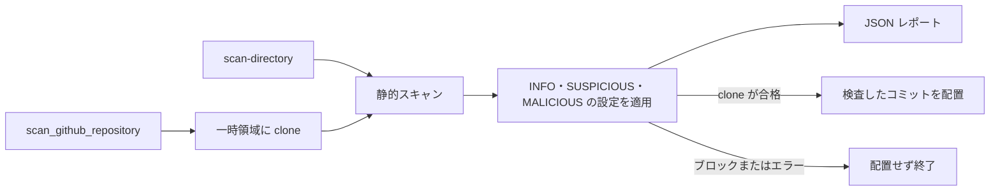

# scan_github_repository

> 本スクリプトは、CODE BLUE 2026 の発表に際して作成した分析スクリプトです。

[English](README.en.md) · [変更履歴](CHANGELOG.md)

Gitリポジトリを一時領域に取得し、設定した検査ポリシーを通過したコミットだけを指定先へ配置するCLIです。取得済みのディレクトリは `scan-directory` で検査できます。



## Ubuntuで使う

Python 3.10以上、Git、およびPythonの仮想環境機能が必要です。配布用wheelを取得し、同じディレクトリで実行します。

```sh
python3 -m venv .venv
.venv/bin/python -m pip install ./scan_github_repository-0.4.2-py3-none-any.whl
.venv/bin/sync-package
.venv/bin/scan_github_repository https://example.org/team/project.git ./checkout
.venv/bin/scan-directory ./existing-project
```

ソースから導入する場合は、展開したプロジェクトの直下で `.venv/bin/python -m pip install .` を実行します。

### 判定データを同期する

配布物に悪性パッケージCSVは入っていません。初回に `sync-package` を実行し、OSVのPyPIエクスポートから、撤回されていないOpenSSFの悪性パッケージ情報を取得します。Datadogの公開マニフェストも使う場合は `sync-package --datadog` を実行します。取得対象はアドバイザリーのメタデータです。

保存先は通常 `~/.local/share/scan_github_repository/` です。Windowsでは `%LOCALAPPDATA%\scan_github_repository`、`XDG_DATA_HOME` を設定済みならその配下を使います。各コマンドに同じ `--data-dir` を指定するか、`SCAN_GITHUB_REPOSITORY_DATA_DIR` を設定すると変更できます。

旧 `scan-clone` から更新する場合は、新しい仮想環境にインストールしてください。同期済みの旧保存先と `SCAN_CLONE_DATA_DIR` は引き継げます。従来の `scan-clone` コマンドも互換名として使えます。

同期は検証済みのCSVに一度に差し替え、失敗時は前回のCSVを維持します。再同期するとローカルCSVが更新されるため、独自の追補は別ファイルに置き、`--intel-csv` で指定します。同期前のスキャンは `missing_intelligence` と終了コード2を返します。オフライン環境では運用者が取得したOSV ZIPを `sync-package --osv-archive ./all.zip` に渡せます。

例のURLは実際のリポジトリURLに置き換えてください。配置先の親ディレクトリは事前に作成します。cloneはHTTPS、SSH、ローカルパスを受け付けます。非公開リポジトリには、事前設定済みのSSHエージェントなどを使います。Ubuntuの配置先ファイルシステムには `renameat2(RENAME_NOREPLACE)` の対応が必要です。

## 検出ルールを設定する

| 設定ファイル | 既定の判定例 |
| --- | --- |
| [info.toml](scan_github_repository/config/info.toml) | プライバシー重視のメールサービス |
| [suspicious.toml](scan_github_repository/config/suspicious.toml) | 短縮URL、実行可能な `.pth`、侵害版を含み得るバージョン範囲 |
| [malicious.toml](scan_github_repository/config/malicious.toml) | 既知の悪性パッケージ、既知の侵害版に固定された依存 |

```sh
mkdir -p local-policy
cp scan_github_repository/config/*.toml local-policy/
.venv/bin/scan-directory --config-dir ./local-policy ./existing-project
```

- **重要度を変える**場合は、対象のルールを別の重要度ファイルの `[rules]` に移します。各ルールは3ファイルのうち1か所に置きます。
- **個別ルールを無効にする**場合は、`[rules]` の値を `false` にします。該当した検出はレポートと判定から除外されます。
- **検出を記録して処理を続ける**場合は、その重要度ファイルの `block = false` を設定します。既定ではINFOを記録し、SUSPICIOUSとMALICIOUSで処理を止めます。0.2系のカスタム設定を指定すると、追加ルールにもその設定の重要度別ブロック方針が適用されます。

標準出力はJSONです。`verdict` は有効な検出のうち最も高い重要度、`blocked` は検出ルールによる停止、`incomplete` は検査未完了を示します。配信処理は終了コード0の場合に進めます。`rules_sha256` は設定と検出ルールを識別し、cloneではコミットSHAも出力します。両コマンドの `--scan-timeout` は既定120秒、cloneの `--clone-timeout` は既定300秒です。

| 終了コード | 意味 |
| --- | --- |
| 0 | ポリシーを通過。cloneの場合は配置済み |
| 1 | ブロック対象の検出あり |
| 2 | 設定や取得・検査・配置のエラー、時間超過、または検査漏れ |

## ファイル構成

```text
scan_github_repository/
  __main__.py                 python -m scan_github_repository の入口
  clone_cli.py                clone、検査、合格後の配置
  scan_cli.py                 scan-directory の入口
  cli_support.py              共通オプションと結果の出力
  scanner.py                  静的検査と判定の組み立て
  source_checks.py            Pythonのimportと実行手順の検出
  policy.py                   判定設定の読み込みと検証
  intelligence.py             悪性パッケージ情報の読み込みと検証
  sync_package.py             公開メタデータの取得・検証・保存
  config/                     重要度ごとのTOML
  vendor/                     Aramasa由来の検出エンジンとデータ
```

## 検査範囲

通常はディレクトリの深さを制限しません。調査の初回確認などで走査量を抑える場合は、`scan-directory --max-depth 4 ./existing-project` を使えます。`scan_github_repository` でも同じオプションが使えます。検査対象のルートを深さ0とし、指定した深さにあるファイルまで読みます。上限より深いディレクトリや `-r`・`-c` の参照先を省いた場合は終了コード2になり、配置は行われません。JSONの `stats.directories_skipped_depth` と `stats.requirement_includes_skipped_depth` が省略件数を示します。全体を検査するには上限を外して再実行します。

対象は、初期チェックアウトまたは指定ディレクトリ内のテキストと対応するPython依存定義です。`.git` 以外のディレクトリを走査し、requirementsのローカル `-r`・`-c` 参照もたどります。対象コードや依存関係のインストーラーは実行しません。既知の侵害版を含む可能性を除外できない範囲指定や、影響バージョンが不明な既知の悪性パッケージはSUSPICIOUSとして報告します。

| 検出対象 | 既定の扱い |
| --- | --- |
| 公開調査で対応が確認された悪性パッケージのPython import | MALICIOUS。同梱モジュール、相対import、コメント、文字列は除外 |
| シェルスクリプト内で明示的なHTTP(S) URLを `curl`・`wget` からシェルに直接渡す処理 | SUSPICIOUS |
| 文書内の同じコマンド例、コメントや文書で参照される短縮URL | INFO |
| 短縮URLをMarkdownのダウンロードリンクとして提示 | SUSPICIOUS |
| ELF・PE・Mach-O | 検査未完了。JSONでは形式別に集計 |

読み取りエラー、5 MiB超のファイル、判読不能なテキスト、実行形式、アーカイブ、LFSポインター、リンク、特殊ファイル、未解決のrequirements参照があれば、終了コード2になります。cloneではGitインデックスにあるサブモジュールとシンボリックリンクも確認します。件数はJSONの `stats` または `unsupported` に出力します。

既知悪性importは `source_checks.py` で対応を確認した名前が対象です。シェル検出はソースに直接記載された単純なパイプを対象とします。Git履歴、他形式のバイナリ内部、動的import、変数で組み立てたコマンド、インストール時の推移依存、未知のマルウェアまでの検出は保証しません。単体スキャンには検査中に更新されないディレクトリを指定してください。

### 悪性パッケージ情報の追加

既定では同期済みローカルCSVを使います。情報源に未収録の調査済みパッケージや社内情報は `--intel-csv` で追加できます。スキャン中は判定データを取得・更新しません。

```sh
.venv/bin/scan-directory --intel-csv ./trusted-intel.csv ./existing-project
```

CSVはUTF-8で、`package,policy,versions,ranges,sources` の列が必要です。ポリシーは `all_versions` か `versions_only` とし、複数のバージョン・範囲はそれぞれの列でセミコロン区切りにします。範囲はPythonのバージョン指定子を使います。追加CSVの情報は同期データに加算されます。判定元には運用者が管理するCSVを使ってください。

例えば次の行は、`example-library` の `1.4.2` と、`2.0` 以上 `2.3` 未満を影響対象にします。

```csv
package,policy,versions,ranges,sources
example-library,versions_only,1.4.2,">=2.0,<2.3",調査レポートのURL
```

影響版への固定はMALICIOUS、影響版を含み得る範囲や未固定の宣言はSUSPICIOUSです。影響範囲と交差しないと確認できる宣言は、このルールでは検出されません。バージョン指定の検出ではJSONに `dependency` を出します。同じ名前について追加CSVが全バージョン対象を指定しても、既存のバージョン限定ルールを優先します。対象リポジトリがその依存を参照していれば、競合を `intel_scope_conflicts` に記録します。

直接URLで指定された同名のGitフォークなどは、実体を照合できないためSUSPICIOUSです。PyPIの公式配布ホストにある同名wheel・ソース配布物は、ファイル名から判明する版を照合します。OSVの修正境界は順序で比較し、修正版より前のプレリリースも対象に含めます。

## ライセンス

scan_github_repositoryは商用利用不可です。[プロジェクトのライセンス](LICENSE)と[第三者由来の資料](NOTICE.md)を参照してください。

