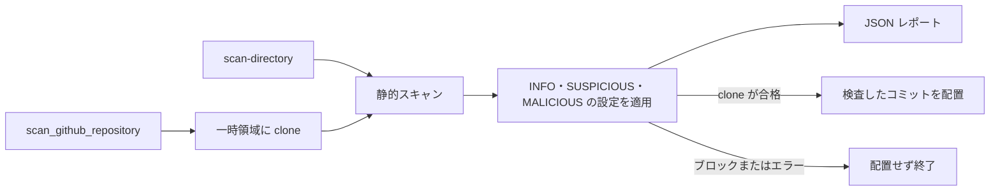

# scan_github_repository

> 本スクリプトは、CODE BLUE 2026 の発表に際して作成した分析スクリプトです。

[English](README.en.md) · [変更履歴](CHANGELOG.md)

Gitリポジトリを一時領域に取得し、設定した検査ポリシーを通過したコミットだけを指定先へ配置するCLIです。取得済みのディレクトリは `scan-directory` で検査できます。



## Ubuntuで使う

Python 3.10以上、Git、pipが必要です。以下の例は、このツールのディレクトリを起点に実行します。

### 1. ソースを取得してインストールする

```sh
git clone https://github.com/LAC-Japan/scan_github_repository.git
cd scan_github_repository
```

仮想環境を使う場合は、インストールの前に次を実行します。

```sh
python3 -m venv .venv
source .venv/bin/activate
```

現在のPython環境に依存パッケージをインストールします。以降のコマンドは、このツールのディレクトリで実行します。

```sh
python3 -m pip install -r requirements.txt
```

旧 `scan-clone` から更新する場合も、同期済みの旧保存先と `SCAN_CLONE_DATA_DIR` は引き継げます。wheelをインストールした環境では、従来の `scan-clone` コマンドも互換名として使えます。

### 2. `sync-package` で判定データを取得する

初回スキャンの前に実行します。

```sh
python3 -m scan_github_repository.sync_package
```

| 取得元 | 取り込む情報 |
| --- | --- |
| [OSVのPyPIエクスポート](https://google.github.io/osv.dev/data/#per-ecosystem-downloads) | 既定の取得元。OpenSSF Malicious Packagesの `MAL-…` 報告からパッケージ名と影響バージョンを取り込み、撤回済み報告を除きます。 |
| [DatadogのPyPIマニフェスト](https://github.com/DataDog/malicious-software-packages-dataset/blob/main/samples/pypi/manifest.json) | 任意の追加取得元。悪性パッケージ名と、報告で特定された影響バージョンを取り込みます。 |

両方の取得元を使う場合は、初回も再同期も次のコマンドを実行します。

```sh
python3 -m scan_github_repository.sync_package --datadog
```

同期したアドバイザリーのメタデータは、ローカルの `malicious_packages.csv` に保存します。保存先は通常 `~/.local/share/scan_github_repository/` です。Windowsでは `%LOCALAPPDATA%\scan_github_repository`、`XDG_DATA_HOME` を設定済みならその配下を使います。各コマンドの `--data-dir` または環境変数 `SCAN_GITHUB_REPOSITORY_DATA_DIR` で変更できます。

同期成功時にCSVを差し替え、失敗時は前回のCSVを使えます。同期前はスキャンが `missing_intelligence` と終了コード2を返します。別途取得したOSV ZIPから初期化する場合は、次のコマンドを使います。

```sh
python3 -m scan_github_repository.sync_package --osv-archive ./all.zip
```

#### 悪性パッケージの検出と判定根拠

スキャン時は、PoCに含まれる `requirements.txt` や `pyproject.toml` などから、依存パッケージ名とバージョンを読み取り、同期済みCSVに照合します。全バージョンが悪性と報告されたパッケージや、侵害が確認された版への固定は `MALICIOUS`、影響版を含み得る未固定の依存や範囲指定は `SUSPICIOUS` です。一部の既知悪性パッケージは、対応を確認済みのPython importからも検出します。どの依存が判定に関わったかはJSONの `category`、`file`、`line`、依存検出時の `dependency` で追えます。アドバイザリーの出典はCSVの `sources` 列で確認できます。

### 3. スキャン方法を選ぶ

#### 新しくcloneしてスキャンする

```sh
python3 -m scan_github_repository https://example.org/team/project.git ./checkout
```

検査を通過したチェックアウトを `./checkout` に配置します。例のURLを実際のリポジトリURLに置き換え、配置先の親ディレクトリを事前に作成してください。HTTPS、SSH、ローカルパスが使えます。非公開リポジトリには事前設定済みのSSHエージェントなどを使います。Ubuntuの配置先ファイルシステムには `renameat2(RENAME_NOREPLACE)` の対応が必要です。

#### クローン済みのリポジトリをスキャンする

```sh
python3 -m scan_github_repository.scan_cli ~/work/existing-repository
```

指定した作業ツリーの現在のファイルをその場で検査します。未コミットの変更も対象です。

#### 任意のディレクトリをスキャンする

```sh
python3 -m scan_github_repository.scan_cli ./extracted-poc
```

展開済みのPoCやリポジトリ内のサブディレクトリなどを指定できます。指定先をルートに再帰的に検査します。

## 検出ルールを設定する

| 設定ファイル | 既定の判定例 |
| --- | --- |
| [info.toml](scan_github_repository/config/info.toml) | プライバシー重視のメールサービス |
| [suspicious.toml](scan_github_repository/config/suspicious.toml) | 短縮URL、実行可能な `.pth`、侵害版を含み得るバージョン範囲 |
| [malicious.toml](scan_github_repository/config/malicious.toml) | 既知の悪性パッケージ、既知の侵害版に固定された依存 |

```sh
mkdir -p local-policy
cp scan_github_repository/config/*.toml local-policy/
python3 -m scan_github_repository.scan_cli --config-dir ./local-policy ./existing-project
```

- **重要度を変える**場合は、対象のルールを別の重要度ファイルの `[rules]` に移します。各ルールは3ファイルのうち1か所に置きます。
- **個別ルールを無効にする**場合は、`[rules]` の値を `false` にします。該当した検出はレポートと判定から除外されます。
- **検出を記録して処理を続ける**場合は、その重要度ファイルの `block = false` を設定します。既定ではINFOを記録し、SUSPICIOUSとMALICIOUSで処理を止めます。0.2系のカスタム設定を指定すると、追加ルールにもその設定の重要度別ブロック方針が適用されます。

標準出力はJSONです。`verdict` は有効な検出のうち最も高い重要度、`blocked` は検出ルールによる停止、`incomplete` は検査未完了を示します。配信処理は終了コード0の場合に進めます。`rules_sha256` は設定と検出ルールを識別し、cloneではコミットSHAも出力します。両コマンドの `--scan-timeout` は既定120秒、cloneの `--clone-timeout` は既定300秒です。

| 終了コード | 意味 |
| --- | --- |
| 0 | ポリシーを通過。cloneの場合は配置済み |
| 1 | ブロック対象の検出あり |
| 2 | 設定や取得・検査・配置のエラー、時間超過、または検査漏れ |

## ファイル構成

```text
scan_github_repository/
  __main__.py                 python -m scan_github_repository の入口
  clone_cli.py                clone、検査、合格後の配置
  scan_cli.py                 scan-directory の入口
  cli_support.py              共通オプションと結果の出力
  scanner.py                  静的検査と判定の組み立て
  source_checks.py            Pythonのimportと実行手順の検出
  policy.py                   判定設定の読み込みと検証
  intelligence.py             悪性パッケージ情報の読み込みと検証
  sync_package.py             公開メタデータの取得・検証・保存
  config/                     重要度ごとのTOML
  vendor/                     Aramasa由来の検出エンジン
```

## 検査範囲

通常はディレクトリの深さを制限しません。調査の初回確認などで走査量を抑える場合は、`python3 -m scan_github_repository.scan_cli --max-depth 4 ./existing-project` を使えます。`scan_github_repository` でも同じオプションが使えます。検査対象のルートを深さ0とし、指定した深さにあるファイルまで読みます。上限より深いディレクトリや `-r`・`-c` の参照先を省いた場合は終了コード2になり、配置は行われません。JSONの `stats.directories_skipped_depth` と `stats.requirement_includes_skipped_depth` が省略件数を示します。全体を検査するには上限を外して再実行します。

対象は、初期チェックアウトまたは指定ディレクトリ内のテキストと対応するPython依存定義です。`.git` 以外のディレクトリを走査し、requirementsのローカル `-r`・`-c` 参照もたどります。対象コードや依存関係のインストーラーは実行しません。既知の侵害版を含む可能性を除外できない範囲指定や、影響バージョンが不明な既知の悪性パッケージはSUSPICIOUSとして報告します。

| 検出対象 | 既定の扱い |
| --- | --- |
| 公開調査で対応が確認された悪性パッケージのPython import | MALICIOUS。同梱モジュール、相対import、コメント、文字列は除外 |
| シェルスクリプト内で明示的なHTTP(S) URLを `curl`・`wget` からシェルに直接渡す処理 | SUSPICIOUS |
| 文書内の同じコマンド例、コメントや文書で参照される短縮URL | INFO |
| 短縮URLをMarkdownのダウンロードリンクとして提示 | SUSPICIOUS |
| ELF・PE・Mach-O | 検査未完了。JSONでは形式別に集計 |

読み取りエラー、5 MiB超のファイル、判読不能なテキスト、実行形式、アーカイブ、LFSポインター、リンク、特殊ファイル、未解決のrequirements参照があれば、終了コード2になります。cloneではGitインデックスにあるサブモジュールとシンボリックリンクも確認します。件数はJSONの `stats` または `unsupported` に出力します。

既知悪性importは `source_checks.py` で対応を確認した名前が対象です。シェル検出はソースに直接記載された単純なパイプを対象とします。Git履歴、他形式のバイナリ内部、動的import、変数で組み立てたコマンド、インストール時の推移依存、未知のマルウェアまでの検出は保証しません。単体スキャンには検査中に更新されないディレクトリを指定してください。

### 悪性パッケージ情報の追加

既定では同期済みローカルCSVを使います。情報源に未収録の調査済みパッケージや社内情報は `--intel-csv` で追加できます。スキャン中は判定データを取得・更新しません。

```sh
python3 -m scan_github_repository.scan_cli --intel-csv ./trusted-intel.csv ./existing-project
```

CSVはUTF-8で、`package,policy,versions,ranges,sources` の列が必要です。ポリシーは `all_versions` か `versions_only` とし、複数のバージョン・範囲はそれぞれの列でセミコロン区切りにします。範囲はPythonのバージョン指定子を使います。追加CSVの情報は同期データに加算されます。判定元には運用者が管理するCSVを使ってください。

例えば次の行は、`example-library` の `1.4.2` と、`2.0` 以上 `2.3` 未満を影響対象にします。

```csv
package,policy,versions,ranges,sources
example-library,versions_only,1.4.2,">=2.0,<2.3",調査レポートのURL
```

影響版への固定はMALICIOUS、影響版を含み得る範囲や未固定の宣言はSUSPICIOUSです。影響範囲と交差しないと確認できる宣言は、このルールでは検出されません。バージョン指定の検出ではJSONに `dependency` を出します。同じ名前について追加CSVが全バージョン対象を指定しても、既存のバージョン限定ルールを優先します。対象リポジトリがその依存を参照していれば、競合を `intel_scope_conflicts` に記録します。

直接URLで指定された同名のGitフォークなどは、実体を照合できないためSUSPICIOUSです。PyPIの公式配布ホストにある同名wheel・ソース配布物は、ファイル名から判明する版を照合します。OSVの修正境界は順序で比較し、修正版より前のプレリリースも対象に含めます。

## ライセンス

scan_github_repositoryは商用利用不可です。[プロジェクトのライセンス](LICENSE)と[第三者由来の資料](NOTICE.md)を参照してください。

